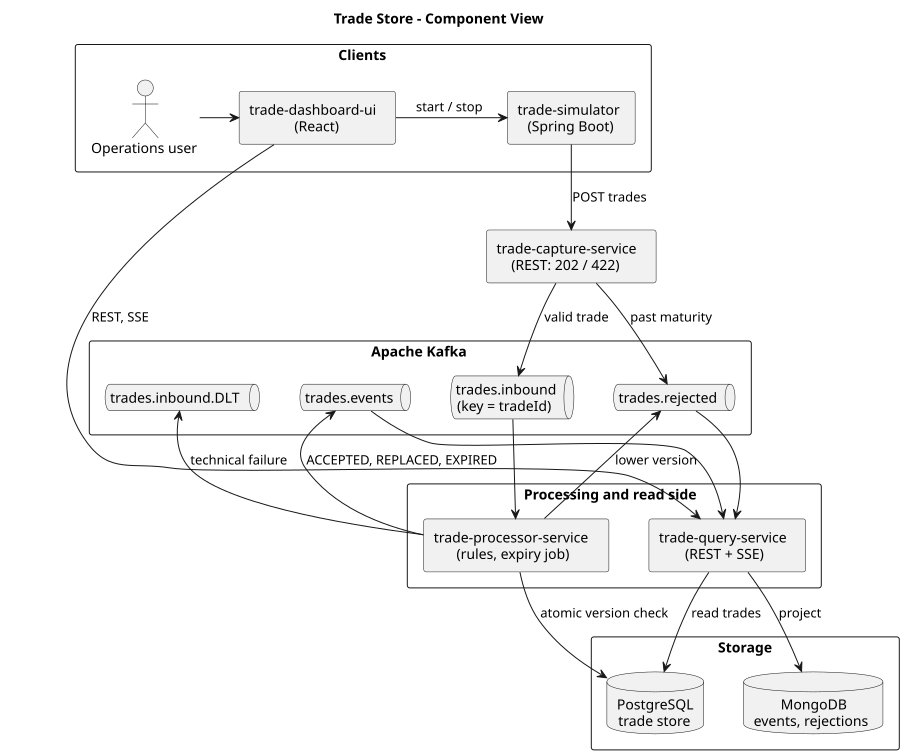

# Trade Store

A distributed trade store built with Java 21, Spring Boot, Apache Kafka, PostgreSQL and MongoDB.
Trades are posted to a capture API, streamed through Kafka, validated and stored by a processor,
and shown on a React dashboard. A simulator generates load.

- Design: [docs/ARCHITECTURE.md](docs/ARCHITECTURE.md)
- Plan and software list: [docs/DEVELOPMENT_PLAN.md](docs/DEVELOPMENT_PLAN.md)
- What was done, step by step: [ACTIVITY_LOG.md](ACTIVITY_LOG.md)



## The rules

| Rule | Behaviour |
|---|---|
| Lower version | Rejected with `LowerVersionTradeException`; recorded as a rejection |
| Same version | Replaces the stored record |
| Higher version | Stored as a new row; earlier versions are kept |
| Maturity date earlier than today | Rejected with `MaturityDatePassedException`; the capture API answers HTTP 422 |
| Maturity date passes later | The expiry job marks the trade `Expired = Y` |

"Today" is the date on the server in the server's own time zone. To use another zone, set
`TRADE_BUSINESS_ZONE` (for example `Europe/London`) on the services.

## Run everything

Only Docker is needed.

```bash
docker compose -f deploy/docker-compose.yml up --build
```

| What | Where |
|---|---|
| Dashboard | http://localhost:8080 |
| Capture API | http://localhost:8081/api/v1/trades |
| Processor (health, metrics) | http://localhost:8082/actuator/health |
| Query API | http://localhost:8083/api/v1/trades |
| Simulator API | http://localhost:8084/api/v1/simulations/current |

Post a trade:

```bash
curl -i -X POST http://localhost:8081/api/v1/trades -H 'Content-Type: application/json' -d '{"tradeId":"T1","version":1,"counterPartyId":"CP-1","bookId":"B1","maturityDate":"2030-05-20"}'
```

Or open the dashboard and use the simulator panel:

- **Quick run** opens a dialog for the bulk settings: number of trades, rate, and the percentage of
  higher-version, same-version, lower-version and past-maturity trades.
- **Detailed run** opens a dialog with the same volume and mix (as sliders) plus the variety of the
  trades: counter-party ids, book ids, how many days ahead maturity dates fall, and a trade id prefix.
  Leave the lists blank to use the built-in pools. Reusing a prefix from an earlier run continues the
  same trade ids, so the store replaces or rejects them by version.

## Develop

Requirements: JDK 21, Maven 3.9+, Docker (for the tests), Node 22+ (for the dashboard).

```bash
mvn verify
```

This runs every backend test, including the integration tests that start Kafka, PostgreSQL and
MongoDB in containers, and fails if line coverage of a module is below 80 %.

Run the services from an IDE against local infrastructure:

```bash
docker compose -f deploy/docker-compose.yml up kafka postgres mongo
```

Then start `CaptureApplication`, `ProcessorApplication`, `QueryApplication` and
`SimulatorApplication`, and the dashboard:

```bash
cd trade-dashboard-ui && npm install && npm run dev
```

### Eclipse

File → Import → Maven → Existing Maven Projects, select the repository root and import the
parent and the five modules. Use a Java 21 JRE.

## Tests

| Level | Where | Needs Docker |
|---|---|---|
| Rules (unit) | `trade-common` | No |
| Store rules on PostgreSQL, expiry, concurrency | `trade-processor-service` | Yes |
| Kafka integration, dead-letter handling | `trade-processor-service`, `trade-capture-service` | Yes |
| HTTP contracts | `trade-capture-service`, `trade-simulator` | No |
| MongoDB projection, query API, live feed | `trade-query-service` | Yes |
| Dashboard | `trade-dashboard-ui` (`npm test`) | No |
| End-to-end regression | `deploy/regression.sh` against the running Compose stack | Yes |

## Pipeline

`.github/workflows/ci.yml` runs on every push and pull request:

1. Backend build and tests with the coverage gate.
2. Dashboard tests and build.
3. Open-source vulnerability scan: Trivy over the Maven and npm dependencies and `npm audit`.
   Any critical finding (CVSS 9.0 or above) fails the build. OWASP Dependency-Check also runs
   when the repository secret `NVD_API_KEY` is set (a free key from https://nvd.nist.gov).
4. End-to-end regression on Docker Compose.

To run the same checks without GitHub:

```bash
mvn verify
```

```bash
docker compose -f deploy/docker-compose.yml up --build -d && deploy/regression.sh
```

```bash
NVD_API_KEY=your-key mvn -Psecurity-scan -DskipTests verify
```

## Known limits

- No authentication or TLS; the APIs are open.
- Single Kafka broker and single database instances in the Compose file.
- The dashboard's live feed is delivered by whichever query-service instance consumed the
  event. With several instances the dashboard still refreshes by polling every three seconds.
- If the processor stops between committing a trade and publishing its event, the trade is
  reprocessed on restart: the same data is written again and the event is then published
  with type `REPLACED` instead of `ACCEPTED`.
