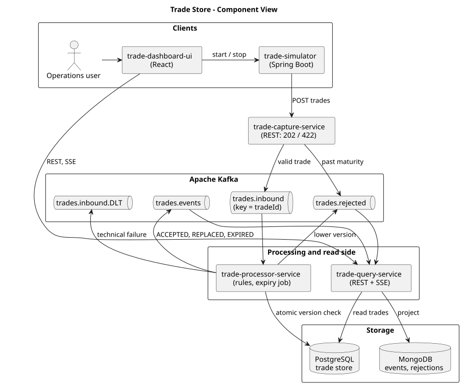
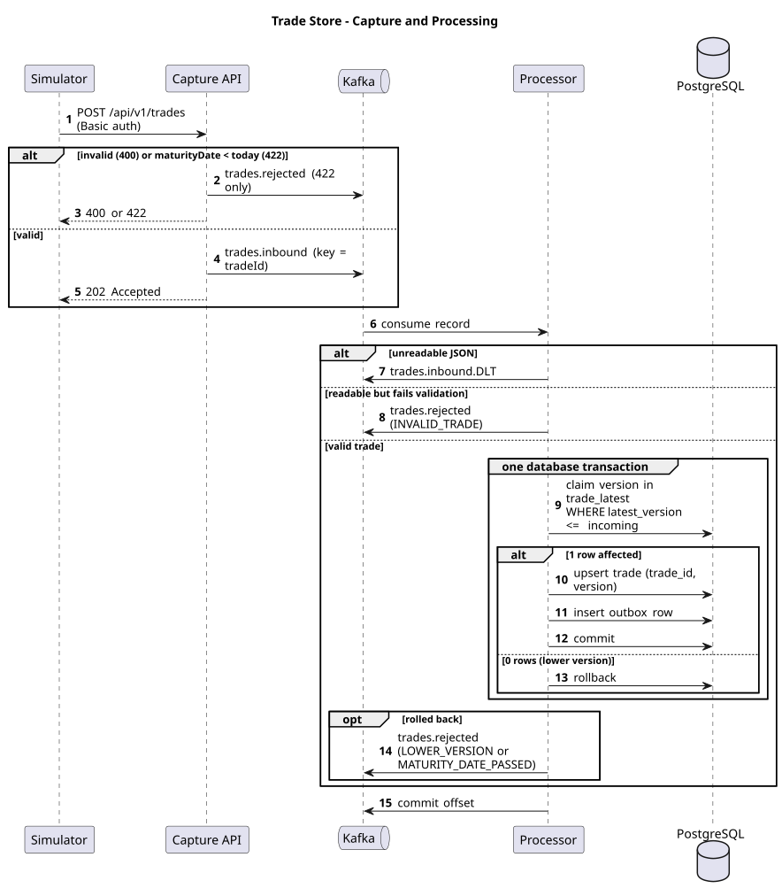
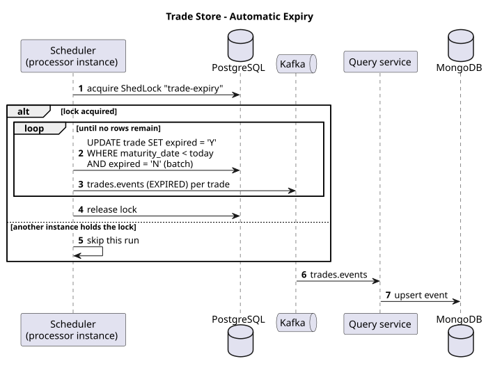

# Trade Store — High-Level Architecture

Status: the original design note. The current, complete design is `docs/Trade-Store-HLD.pdf` (version 1.1); where the two differ, for example the transactional outbox, the invalid-trade rejection, the retry policy, the read-only database account and the security model, the HLD is correct.
Repository: https://github.com/vijaydixitffis/dws-trade-app
Source: "VD Trade Assignment – For Architect Lead role" (PDF).

## 1. What the assignment requires

| # | Requirement (from the document) | Where it is met |
|---|---|---|
| R1 | Java + Spring Boot | All backend services |
| R2 | A streaming tool | Apache Kafka between capture and processing |
| R3 | Both SQL and NoSQL databases | PostgreSQL (trade store) + MongoDB (audit and rejections) |
| R4 | All functionality covered by JUnit, TDD approach | Section 8 and `DEVELOPMENT_PLAN.md` |
| R5 | Pipeline (GitHub Actions preferred) with automated regression tests | `.github/workflows/ci.yml` |
| R6 | OSS vulnerability scan; build fails on critical/blocker | OWASP Dependency-Check, `failBuildOnCVSS=9` |
| R7 | PlantUML diagrams if feasible | `docs/diagrams/*.puml` |
| V1 | Lower version is rejected with an exception; same version replaces | Processor + atomic SQL guard |
| V2 | Reject a trade whose maturity date is earlier than today | Capture pre-check + processor (authoritative) |
| V3 | Automatically mark trades expired once maturity has passed | Expiry scheduler in the processor |
| P1 | Thousands of trades, any transmission method, stored in a specific sequence | Kafka partitioned by `tradeId`; store ordered by `tradeId`, `version` |

The simulator and dashboard are additions you asked for; they are not in the document.

## 2. Decisions taken (from your answers)

| Topic | Decision | Reason |
|---|---|---|
| Streaming | Apache Kafka, single-node KRaft, official `apache/kafka` image | One container, no ZooKeeper, no licence; the same image runs on a laptop, in GitHub Actions (via Testcontainers) and at a client site with only Docker installed |
| SQL | PostgreSQL | System of record; ACID and an atomic version check |
| NoSQL | MongoDB | Append-only history of every trade event and every rejection |
| Packaging | Separate Spring Boot services in one Maven multi-module repo | Each scales independently; one `docker compose up` runs everything |
| Rejections | Domain exception, Kafka rejected topic, stored in MongoDB, shown in the dashboard, plus an immediate HTTP 422 where the capture API can decide on its own | Your "option 1 plus 3" |

## 3. Components

Your four components are kept. Two things are added: a separate read-side service, and Kafka topics for outcomes.

| Component | Type | Responsibility | State |
|---|---|---|---|
| **trade-simulator** (your "trade poster") | Spring Boot app | Generates trades at a configurable rate and mix (valid, same version, lower version, past maturity) and posts them to the capture API | None |
| **trade-capture-service** | Spring Boot REST | Accepts single and batch trades. Checks structure and the maturity rule. Publishes to `trades.inbound` keyed by `tradeId`. Returns `202 Accepted`, or `422` for a past maturity date | None |
| **Kafka** | Streaming | `trades.inbound`, `trades.events`, `trades.rejected`, `trades.inbound.DLT` | Log |
| **trade-processor-service** (engine) | Spring Boot Kafka consumer | Applies V1 and V2, writes the trade store, publishes the outcome. Runs the expiry scheduler (V3) | PostgreSQL |
| **PostgreSQL** | SQL | The trade store | — |
| **trade-query-service** | Spring Boot REST + SSE | Projects `trades.events` and `trades.rejected` into MongoDB. Serves the dashboard: trades from PostgreSQL, history and rejections from MongoDB, live feed over Server-Sent Events | MongoDB |
| **MongoDB** | NoSQL | `trade_events`, `trade_rejections` | — |
| **trade-dashboard-ui** | React + Vite + TypeScript | Trade store table, rejections tab, live counters, simulator controls. Plain corporate styling: blue, grey and white only | None |

Why a separate query service: the processor's only job is to keep up with the inbound stream. Dashboard reads and browser connections must not compete with it for threads or database connections.

Why the capture API does not write to the database: it stays stateless and fast, Kafka absorbs bursts, and the processor can be stopped or redeployed without losing trades.

## 4. Data flow

1. The simulator posts a trade to `POST /api/v1/trades`.
2. Capture checks the payload. A maturity date before today returns `422` and the trade is also published to `trades.rejected`, so it is stored and visible. Otherwise the trade is published to `trades.inbound` with key `tradeId` and the caller gets `202`.
3. The processor consumes `trades.inbound`. It re-checks maturity (other producers may write to the topic directly — "any method of transmission") and applies the version rule in one database transaction.
4. Accepted or replaced: the row is committed to PostgreSQL and an event is published to `trades.events`.
   Rejected: `LowerVersionTradeException` or `MaturityDatePassedException` is raised, caught at the listener boundary, and the trade is published to `trades.rejected` with the reason.
5. The Kafka offset is committed only after step 4 has finished.
6. The query service consumes both outcome topics, writes them to MongoDB and pushes them to connected dashboards.
7. The expiry scheduler marks matured trades `expired = 'Y'` and publishes `EXPIRED` events.

A business rejection is a normal outcome and goes to `trades.rejected`. A technical failure (unreadable message, database down after retries) goes to `trades.inbound.DLT`. The two are kept apart so operations can tell bad trades from broken infrastructure.

## 5. The three rules in detail

### V1 — version

The sample table holds T2 at version 2 and version 1 as two rows, so the store keeps one row per `(tradeId, version)`.

| Incoming version vs highest stored | Result |
|---|---|
| Higher, or first for that trade | Insert a new row |
| Equal | Replace the existing row |
| Lower | Reject with `LowerVersionTradeException` |

The check is done by the database, not in Java memory, so it stays correct with several processor instances:

```sql
-- one row per trade, holds the highest version seen
INSERT INTO trade_latest (trade_id, latest_version) VALUES (:id, :v)
ON CONFLICT (trade_id) DO UPDATE SET latest_version = EXCLUDED.latest_version
WHERE trade_latest.latest_version <= EXCLUDED.latest_version;
-- 0 rows affected  => lower version => reject
-- 1 row affected   => upsert into trade (trade_id, version) in the same transaction
```

Kafka partitioning by `tradeId` gives the ordering; this guard gives the correctness if ordering is ever broken (rebalance, replay, a second producer).

### V2 — maturity

`maturityDate < today` is rejected. A trade maturing today is accepted. "Today" is the date on the server, in the server's own time zone. An administrator can override the zone with the property `trade.business-zone` (environment variable `TRADE_BUSINESS_ZONE`, for example `Europe/London`); when it is empty the server default applies. The date is read through an injected `java.time.Clock`, so tests can fix it.

### V3 — expiry

A scheduled job in the processor runs shortly after midnight and at startup:

```sql
UPDATE trade SET expired = 'Y' WHERE maturity_date < :today AND expired = 'N';
```

ShedLock (PostgreSQL lock table) ensures only one processor instance runs it. The update is in batches and each batch publishes `EXPIRED` events.

## 6. Data model

**PostgreSQL** (schema managed by Flyway)

```
trade_latest (trade_id PK, latest_version)
trade        (trade_id, version, counter_party_id, book_id,
              maturity_date, created_date, expired CHAR(1),
              PRIMARY KEY (trade_id, version))
index on trade (maturity_date) WHERE expired = 'N'
```

"Stored in a specific sequence" is read as the order shown in the sample table: `trade_id` ascending, then `version` descending. The primary key and the query API both use it.

**MongoDB**

```
trade_events      { _id: "<topic>-<partition>-<offset>", type: ACCEPTED|REPLACED|EXPIRED, trade, at }
trade_rejections  { _id: "<topic>-<partition>-<offset>", reason, trade, source: CAPTURE|PROCESSOR, at }
```

The `_id` is taken from the inbound Kafka position, so replaying a message overwrites the same document instead of duplicating it.

## 7. High volume, distribution and failure handling

| Concern | Approach |
|---|---|
| Throughput in | Capture is stateless, runs on Java 21 virtual threads, has a batch endpoint, and uses a batching, compressed Kafka producer |
| Throughput through | `trades.inbound` has 6 partitions to start; processor runs one consumer thread per partition |
| Scale out | Add capture instances behind a load balancer; add processor instances up to the partition count |
| Ordering | Key = `tradeId`, so all versions of a trade go to one partition and one consumer thread |
| No loss | Producer `acks=all` with idempotence; consumer commits offsets only after the database commit and outcome publish |
| Duplicates | Delivery is at-least-once. Reprocessing is harmless: the same version replaces itself, and MongoDB documents are keyed by Kafka position |
| Back-pressure | Kafka buffers; consumer lag is the signal to scale |
| Poison messages | Bounded retries with back-off, then `trades.inbound.DLT` |
| Observability | Spring Actuator, Micrometer metrics (accepted, rejected by reason, lag, latency), correlation id from HTTP header through Kafka header to logs |

Not included in this scope, to be stated in the README: authentication, TLS, multi-broker Kafka, database replication, Kubernetes manifests. The design allows all of them without change to the services.

## 8. Test strategy (TDD)

Every rule starts as a failing test. The commit history will show the test commit before the implementation commit.

| Level | Tooling | Covers |
|---|---|---|
| Unit | JUnit 5, AssertJ, Mockito, fixed `Clock` | Version and maturity rules, expiry selection, event mapping |
| Slice | `@WebMvcTest`, `@JdbcTest` + Testcontainers PostgreSQL, `@DataMongoTest` + Testcontainers MongoDB | HTTP contract, the atomic SQL guard, projections |
| Integration | Testcontainers Kafka + PostgreSQL + MongoDB, Awaitility | Capture → Kafka → processor → store → outcome topics |
| Concurrency | Many threads sending mixed versions of one trade | Final state always equals the highest version |
| Regression (end to end) | Docker Compose + a scripted scenario (accept, higher version, same version, lower version, past maturity) using dates relative to today | The whole system; runs in the pipeline |
| UI | Vitest + React Testing Library | Table, rejection tab, live updates |
| Coverage gate | JaCoCo | Build fails below the threshold (proposed 90 % line coverage on rule and service classes) |

## 9. Pipeline (GitHub Actions)

```
push / pull request
 ├─ build + unit + slice tests      mvn verify            (JaCoCo gate)
 ├─ integration + regression tests  Testcontainers, Docker Compose
 ├─ OSS vulnerability scan          OWASP Dependency-Check  failBuildOnCVSS=9
 │                                  npm audit --audit-level=critical  (UI)
 ├─ UI build + tests                npm ci, vitest, vite build
 └─ package                         Docker images per service (on main)
```

"Critical" maps to CVSS 9.0 and above. "Blocker" is a SonarQube severity; if you want that covered too, a SonarCloud quality gate can be added as one more job.

The same pipeline can be run on a laptop or at the client with `act` (runs GitHub Actions workflows in Docker), or without it by running `mvn verify` and `docker compose up`. OWASP Dependency-Check needs a free NVD API key to download its data in reasonable time; it is stored as a repository secret. Trivy is the fallback if a key is not available: it needs none.

## 10. Diagrams

PlantUML sources with rendered SVG images beside them:

- `docs/diagrams/component.puml` / `component.svg` — components and topics
- `docs/diagrams/sequence-trade-flow.puml` / `sequence-trade-flow.svg` — accepted, replaced and rejected paths
- `docs/diagrams/sequence-expiry.puml` / `sequence-expiry.svg` — expiry job







Class diagrams will be added per module as the code is written.

## 11. Points read from the document — decisions

| # | Point | Decision |
|---|---|---|
| A1 | Does the store keep every version of a trade, or only the latest? | Every version, as in the sample table (T2 v2 and T2 v1). **Confirmed 2026-11-12.** |
| A2 | Is a trade maturing today accepted? | Yes — only "earlier than today" is rejected (default, not objected to) |
| A3 | Which time zone defines "today"? | The server's date and time zone; configurable by an administrator. **Confirmed 2026-11-12.** |
| A4 | When the same version replaces a record, does Created Date change? | Yes, to the date the replacement was received (default, not objected to) |
| A5 | Sample rows T1 and T3 contradict the rules if taken literally (T1 matured in 2020 but is not expired; T3 matured in 2014 but was created today) | Sample trades dated 2020 and earlier are ignored; tests use dates relative to today. **Confirmed 2026-11-12.** |
